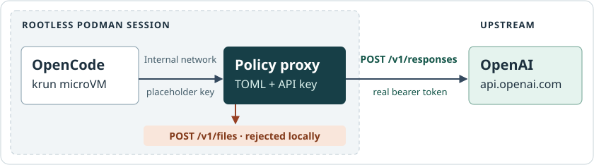

# hobgoblin sandbox

Run a coding agent on your project and decide which network requests it can
make. The agent works in a Linux microVM; a separate proxy holds the API keys
and enforces a TOML policy. You can let OpenCode call the OpenAI Responses API
without giving its shell your key or access to the rest of the OpenAI API.

- **Limit what agent commands can change.** Shell commands and project scripts
  run in a microVM with its own kernel. The workspace is shared read-write, so
  edits and deletions there still affect your checkout.
- **Deny outbound access by default.** The guest has no direct internet route.
  For inspected HTTPS traffic, you can allow a specific API method and path
  without granting access to the whole service. An allowed request can still
  carry project data.
- **Keep API keys out of the agent shell.** The proxy reads the configured
  Podman secret and adds the credential to matching requests. Tools in the
  guest can use the permitted API with a placeholder key.
- **Review network activity after a run.** The proxy writes its audit log
  outside the guest. Use `hobgobs audit SESSION_ID` to see which destinations
  the agent requested and why the proxy denied a request.

## Run OpenCode

We plan to publish the launcher on PyPI and provide prebuilt versions of the
standard agent and proxy images. For now, clone this repository and follow
the **First run?** instructions below to set up your host, build the images,
and create the API secret.

From the hobgoblin checkout:

```bash
hobgobs run --policy examples/opencode.toml -- /root/.opencode/bin/opencode
```

<details>
<summary><strong>First run?</strong> Set up the host and create the API secret once.</summary>

Use a Fedora/RHEL host with Python 3.12+, rootless Podman 5+ using Netavark,
and read/write access to `/dev/kvm`. Install the launcher and build the
images as the user who will run the agent:

```bash
sudo dnf install make python3 python3-pip podman crun-krun passt container-selinux
make install images
export PATH="$HOME/.local/bin:$PATH"
hobgobs doctor
```

If `doctor` reports that `/dev/kvm` is inaccessible, add your user to the
`kvm` group (`sudo usermod -aG kvm "$USER"`), then log out and back in.
With `OPENAI_API_KEY` set on the host, store it for the proxy:

```bash
printf '%s' "$OPENAI_API_KEY" | podman secret create openai_api_key -
```

</details>

Select an OpenAI model in OpenCode. Everything after `--` runs in the VM.
The current directory is mounted **read-write** at `/workspace`; to edit
another repo, add `--workspace "$HOME/src/myproject"` before `--`.
Keep the policy you rely on outside that writable repo so the agent cannot
change the rules for its next run.

## Architecture overview

The host launcher uses rootless Podman to start the agent microVM and a
separate proxy. They share an internal network; only the proxy also connects
to the outbound network.

### Container images

Installing the Python package gives you the `hobgobs` launcher. To run a
sandbox, build its two images with `make images` from the checkout, using the
same rootless Podman user that will run `hobgobs`:

- [`localhost/hobgoblin-agent:latest`](containers/agent/Containerfile) runs
  inside the microVM and includes OpenCode, Claude Code, and development tools.
  To use your own toolchain, pass `--image IMAGE` to `hobgobs run`.
- [`localhost/hobgoblin-proxy:latest`](containers/proxy/Containerfile) runs
  outside the microVM. It enforces the network policy and adds credentials to
  allowed requests, so the agent never needs the real API key.

Run `hobgobs doctor` to check that both default images are available locally.

### How a request gets out



The guest has no DNS resolver or direct internet route. For inspected HTTPS
traffic, the proxy checks the host, port, method and path before adding
credentials. The rule controls *where* the
agent can send data; an allowed request can still contain project content.

## What survives `exit`?

| Resource | After the session |
| --- | --- |
| **Project files** | Edits are already on the host, including after `--no-state`. |
| **History and settings** | The same workspace gets the same `/state` directory. Use `--no-state` for a fresh session or `--state DIR` to choose the directory. |
| **Network audit** | The proxy log stays on the host. `hobgobs audit SESSION_ID` shows destinations and reasons for denials. |
| **VM** | The launcher removes the agent, proxy and session networks by default. |

## Pick a policy

| Start with | What it permits |
| --- | --- |
| [OpenCode + OpenAI](examples/opencode.toml) | Model requests and model lookup; the proxy supplies the bearer token. Also allows reads from the OpenCode model catalog. |
| [Claude Code + Anthropic](examples/claude.toml) | Messages and token counting; the proxy supplies `x-api-key`. |
| [Development example](examples/policy.toml) | Git fetches for one GitHub organization, package registries and both model providers. Replace `myorg` and trim unused rules. |

Run `hobgobs check-policy examples/opencode.toml` to see the rules and
required secrets before starting a VM.

**Next:** [Try a policy in a shell, no key needed](docs/guide.md#try-a-policy-without-an-api-key)
 · [Run Claude Code](docs/guide.md#run-claude-code)
 · [Investigate a denial](docs/guide.md#investigate-a-denial)
 · [Development and verification](docs/guide.md#development-and-verification)

[License](LICENSE)
